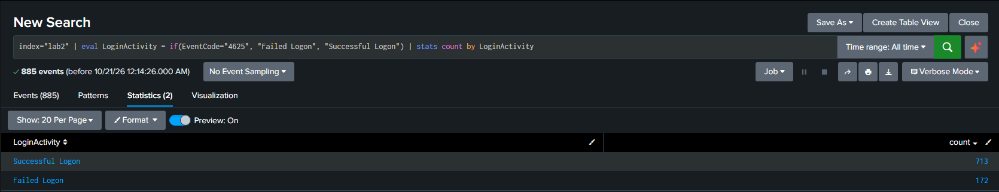
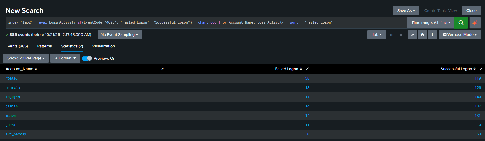
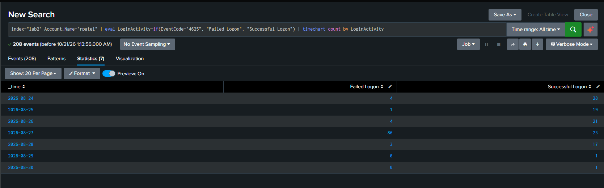

# Lab 02: Windows Authentication Statistical Analysis

## Overview
I analyzed a synthetic Windows authentication dataset created to practice triage on security telemetry. The purpose of this lab was to use statistical analysis within Splunk to quickly identify and investigate anomalous authentication activity that could potentially be malicious.

Note: All accounts, systems, events, and network activity represented in this dataset are fictional.

## Investigation Objectives
- Analyze overall Windows authentication activity.
- Identify accounts generating the most authentication activity.
- Identify unusually frequent or rare authentication patterns.
- Analyze changes in authentication activity over time.
- Use statistical analysis to identify activity that stands out from normal behavior.
- Determine whether any identified activity warrants further investigation or escalation.

## Dataset Overview
- Going into the lab, the dataset was uploaded and indexed, resulting in 885 Windows authentication events available for analysis.
- The fields available for the triage were `EventCode`, `Account_Name`, `Computer`, `Source_Network_Address`, `Logon_Type`, `Failure_Reason`, `Status`, and `_time`.

## Authentication Activity Analysis
### Overall Authentication Activity

When I began triaging the dataset, I wanted to understand overall authentication activity. To do this, I categorized  `EventCode ` 4624 as successful and 4625 as failed. The overall authentication activity included 713 successful logons and 172 failed logons.
```spl
index="lab2" | eval LoginActivity=if(EventCode="4625", "Failed Logon", "Successful Logon") | stats count by LoginActivity
```


### Account Activity Comparison

Now that we understand the overall authentication activity, I wanted to further categorize the data and identify the authentication activity for individual accounts. To compare successful and failed logons by `Account_Name` I used the `chart` command. Additionally, I used `sort` to rank the account from the most failed logons to the least.

Through this query, I was able to identify user `rpatel` as having the most authentication activity, with 208 total events and 98 failed logons, substantially more failures than other user accounts. This led me to investigate `rpatel` further.
```spl
index="lab2" | eval LoginActivity=if(EventCode="4625", "Failed Logon", "Successful Logon") | chart count by Account_Name, LoginActivity | sort - "Failed Logon"
```


## rpatel Investigation

### Authentication Activity Over Time

Due to the significant deviation in failed logons for user `rpatel`, I used the `timechart` command with a 1-day span to identify any potential anomalies. This showed that user `rpatel` had 86 failed logons on August 27th; meanwhile, the rest of the days had no more than 4 failed logons.

```spl
index="lab2" Account_Name="rpatel" | eval LoginActivity=if(EventCode="4625", "Failed Logon", "Successful Logon") | timechart count by LoginActivity
```



The significant deviation of failed logons on August 27th led me to narrow my investigation down to activity on that day.
