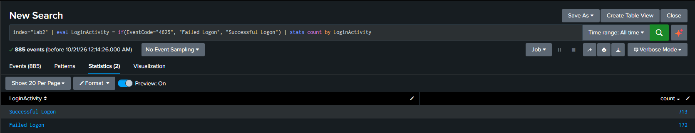
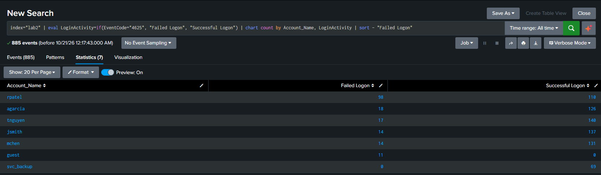
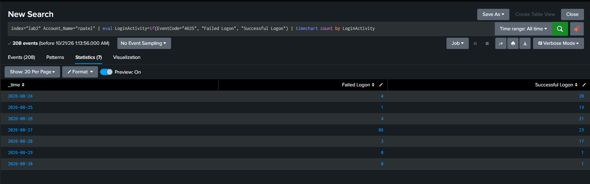
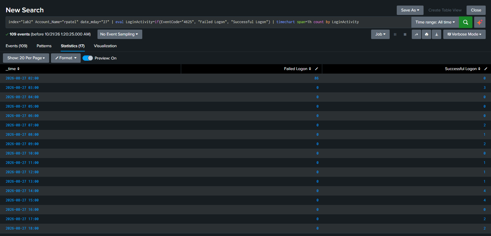
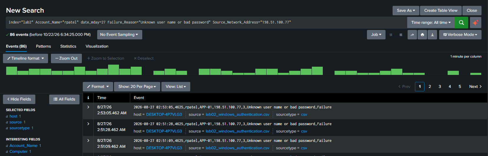
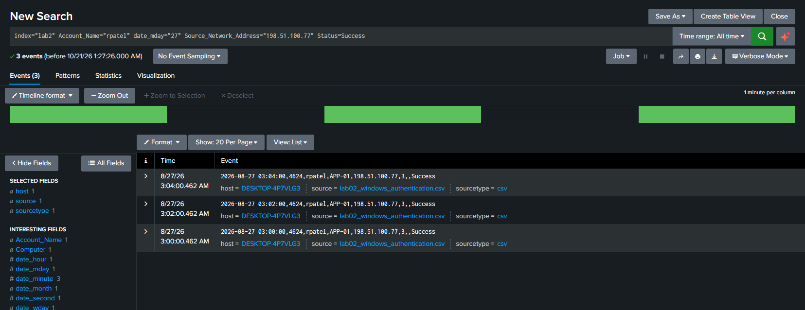
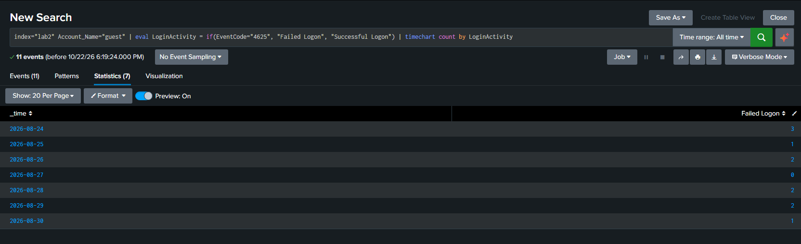
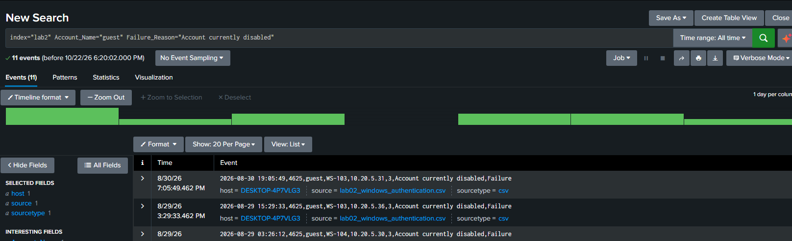
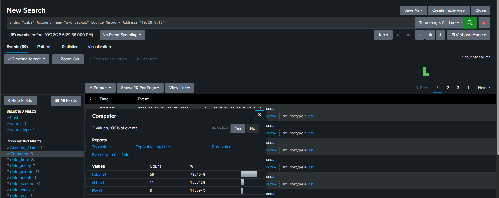

# Lab 02: Windows Authentication Statistical Analysis

## Overview
I analyzed a synthetic Windows authentication dataset created to practice triage on security telemetry. The purpose of this lab was to use statistical analysis within Splunk to quickly identify and investigate anomalous authentication activity that could potentially be malicious.

Note: All accounts, systems, events, and network activity represented in this dataset are fictional.

## Investigation Objectives
- Analyze overall Windows authentication activity.
- Identify accounts generating the most authentication activity.
- Identify unusually frequent or rare authentication patterns.
- Analyze changes in authentication activity over time.
- Use statistical analysis to identify activity that stands out from normal behavior.
- Determine whether any identified activity warrants further investigation or escalation.

## Dataset Overview
- Going into the lab, the dataset was uploaded and indexed, resulting in 885 Windows authentication events available for analysis.
- The fields available for the triage were `EventCode`, `Account_Name`, `Computer`, `Source_Network_Address`, `Logon_Type`, `Failure_Reason`, `Status`, and `_time`.

## Authentication Activity Analysis
### Overall Authentication Activity

When I began triaging the dataset, I wanted to understand overall authentication activity. To do this, I categorized  `EventCode ` 4624 as successful and 4625 as failed. The overall authentication activity included 713 successful logons and 172 failed logons.
```spl
index="lab2" | eval LoginActivity=if(EventCode="4625", "Failed Logon", "Successful Logon") | stats count by LoginActivity
```


### Account Activity Comparison

Now that we understand the overall authentication activity, I wanted to further categorize the data and identify the authentication activity for individual accounts. To compare successful and failed logons by `Account_Name` I used the `chart` command. Additionally, I used `sort` to rank the account from the most failed logons to the least.

Through this query, I was able to identify user `rpatel` as having the most authentication activity, with 208 total events and 98 failed logons, substantially more failures than other user accounts. This led me to investigate `rpatel` further.
```spl
index="lab2" | eval LoginActivity=if(EventCode="4625", "Failed Logon", "Successful Logon") | chart count by Account_Name, LoginActivity | sort - "Failed Logon"
```


## rpatel Investigation

### Authentication Activity Over Time

Due to the significant deviation in failed logons for user `rpatel`, I used the `timechart` command with a 1-day span to identify any potential anomalies. This showed that user `rpatel` had 86 failed logons on August 27th; meanwhile, the rest of the days had no more than 4 failed logons.

```spl
index="lab2" Account_Name="rpatel" | eval LoginActivity=if(EventCode="4625", "Failed Logon", "Successful Logon") | timechart count by LoginActivity
```



The significant deviation of failed logons on August 27th led me to narrow my investigation down to activity on that day.

### August 27 Authentication Activity

Querying August 27th with the `timechart` command and a 1-hour span allowed me to see all 86 failed logons occurred between 2 and 3 a.m. Additionally, 3 successful logons occurred shortly after 3 a.m. This concentration of failed logon attempts led me to further investigate the failed attempts. 

```spl
index="lab2" Account_Name="rpatel" date_mday="27" | eval LoginActivity=if(EventCode="4625", "Failed Logon", "Successful Logon") | timechart span=1h count by LoginActivity
```



### Failed Logon Analysis

All 86 failed logon attempts had the failure reason Unknown username or bad password. All logon attempts were Type 3 network logons originating from the IP `198.51.100.77`, targeting the account `rpatel` on `APP-01`.



### Successful Authentication Analysis

Further analysis of IP address 198.51.100.77 revealed 3 successful logon attempts on the account `rpatel` on `APP-01` shortly after the failed attempts. The 86 failed logon attempts followed by successful logons from the same source is consistent with a potential brute-force attempt. Based on the evidence, I would escalate this activity for further investigation.



## Additional Account Analysis

### Guest Account Investigation

I checked the Guest account’s logon activity because all attempts on that account were failures. The logon activity spanned over a week, with no more than 3 failures per day. 



Further investigation revealed that the logon failures were due to the Guest account being disabled. Additionally, the failures were network logons from internal private IP addresses in the 10.20.5.x range and originated from different computers.



### Service Account Investigation

`svc_backup` had **69 successful logon attempts with 0 failed attempts**. Due to the 100% success rate, I investigated the account further. All logon attempts originated from the IP `10.20.5.10`, with **50 logons to FILE-01, 11 logons to APP-01, and 8 logons to DC-01**. This activity is consistent with expected backup activity based on the available evidence. No anomalous activity was identified, so no escalation was necessary.


